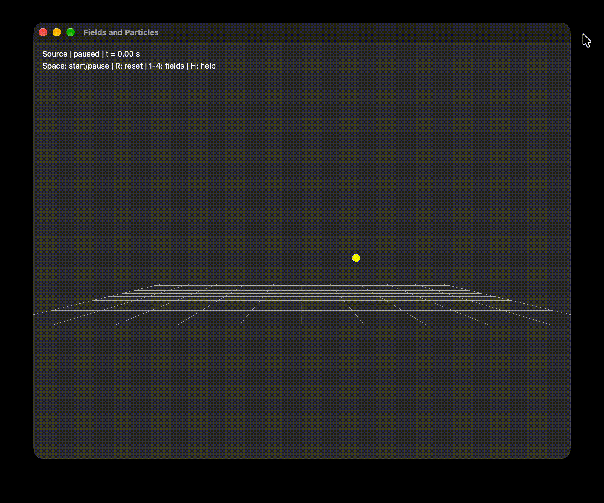
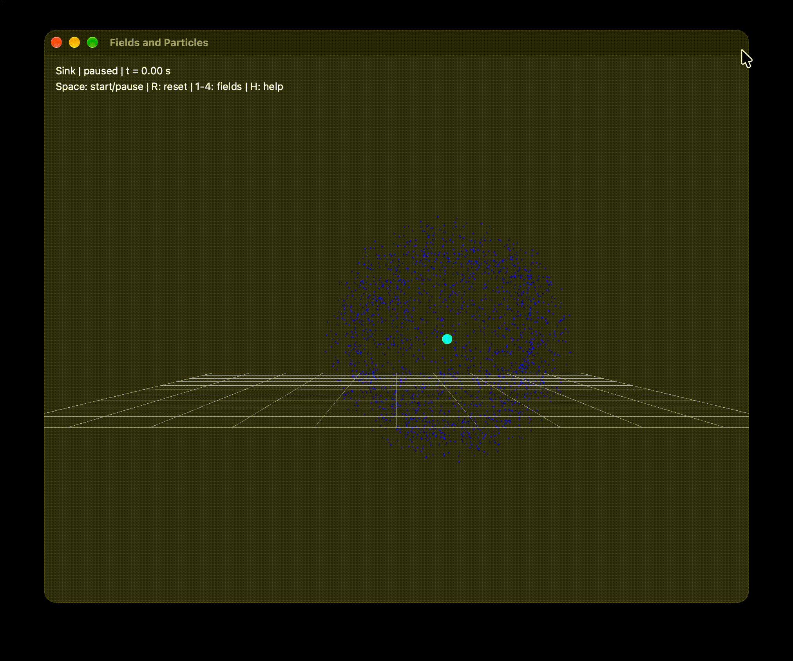
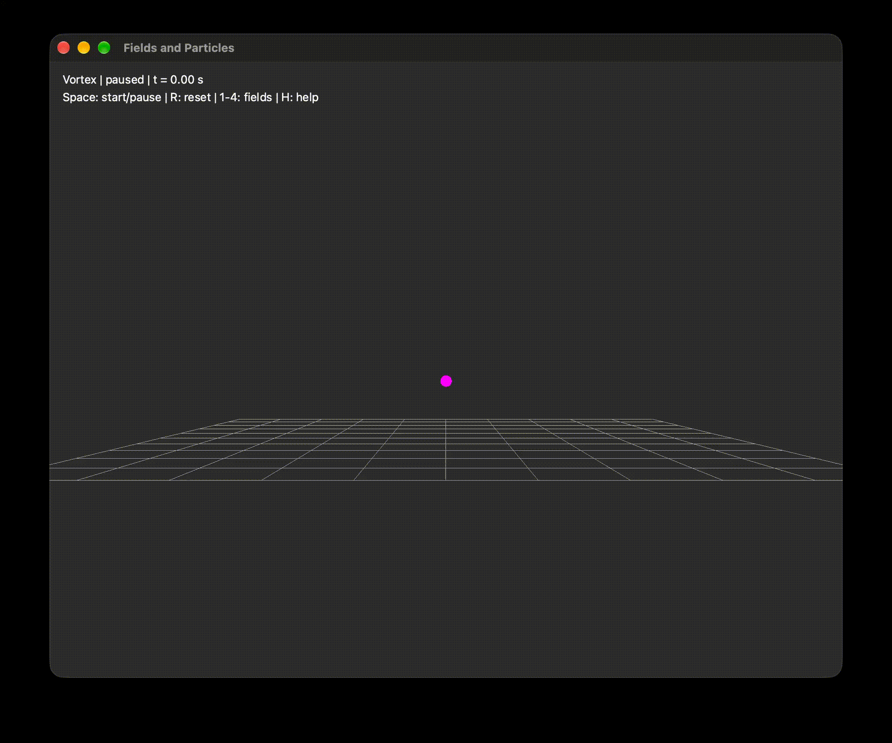
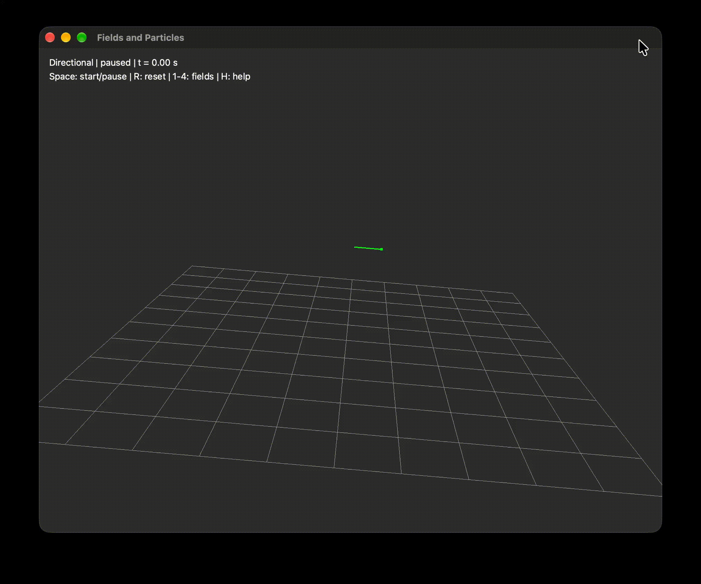

# Fields and Particles

A C++ particle system simulation using Qt5 and QGLViewer for visualization.

## Prerequisites

- [CMake](https://cmake.org/)
- [Qt5](https://www.qt.io/)
- [Clang](https://clang.llvm.org/)
- [clang-format](https://clang.llvm.org/docs/ClangFormat.html)

## Usage

### Build and run

Press Space to start or pause the animation.

#### Source

```sh
cmake -S . -B .build -DCMAKE_BUILD_TYPE=Release -DFIELD=source
cmake --build .build --parallel
cmake --build .build --target run
```



#### Sink

```sh
cmake -S . -B .build -DFIELD=sink
cmake --build .build --parallel
cmake --build .build --target run
```



#### Vortex

```sh
cmake -S . -B .build -DFIELD=vortex
cmake --build .build --parallel
cmake --build .build --target run
```



#### Directional

```sh
cmake -S . -B .build -DFIELD=directional
cmake --build .build --parallel
cmake --build .build --target run
```



### Format

```sh
cmake --build .build --target format
cmake --build .build --target format-check
```
